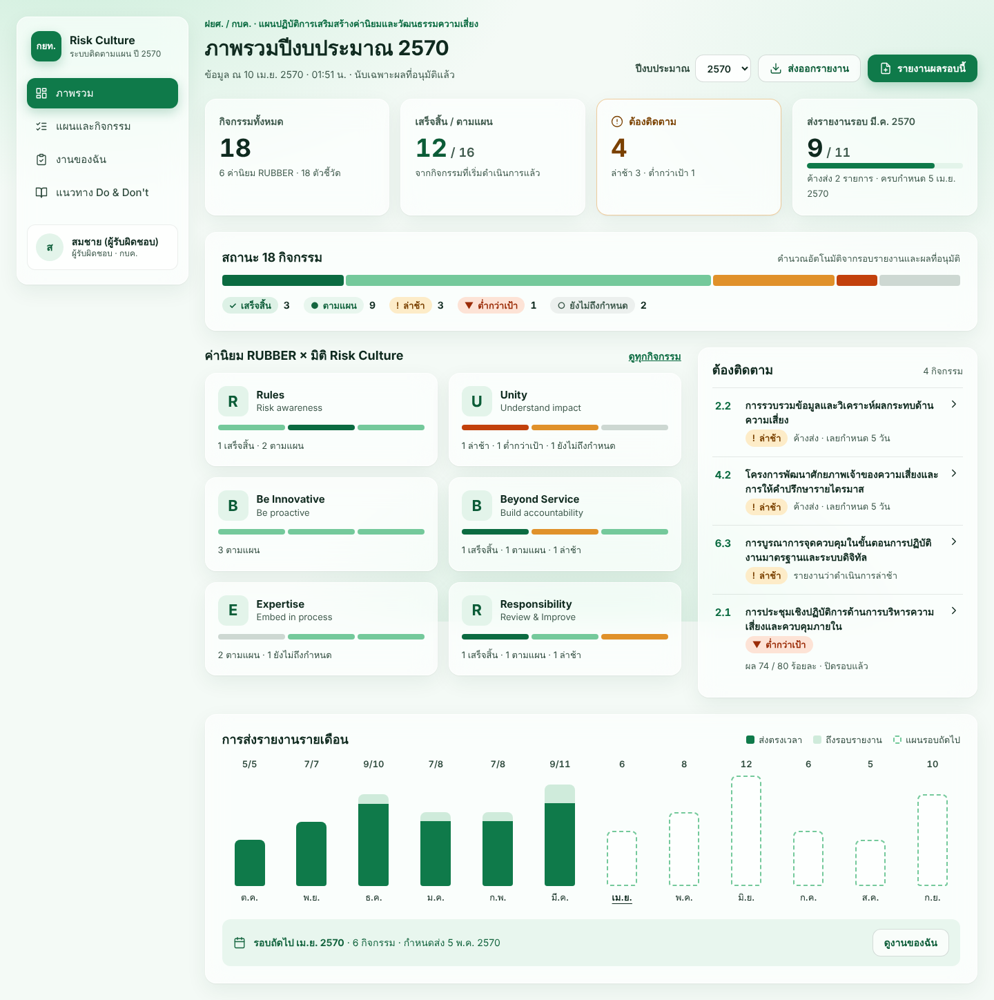
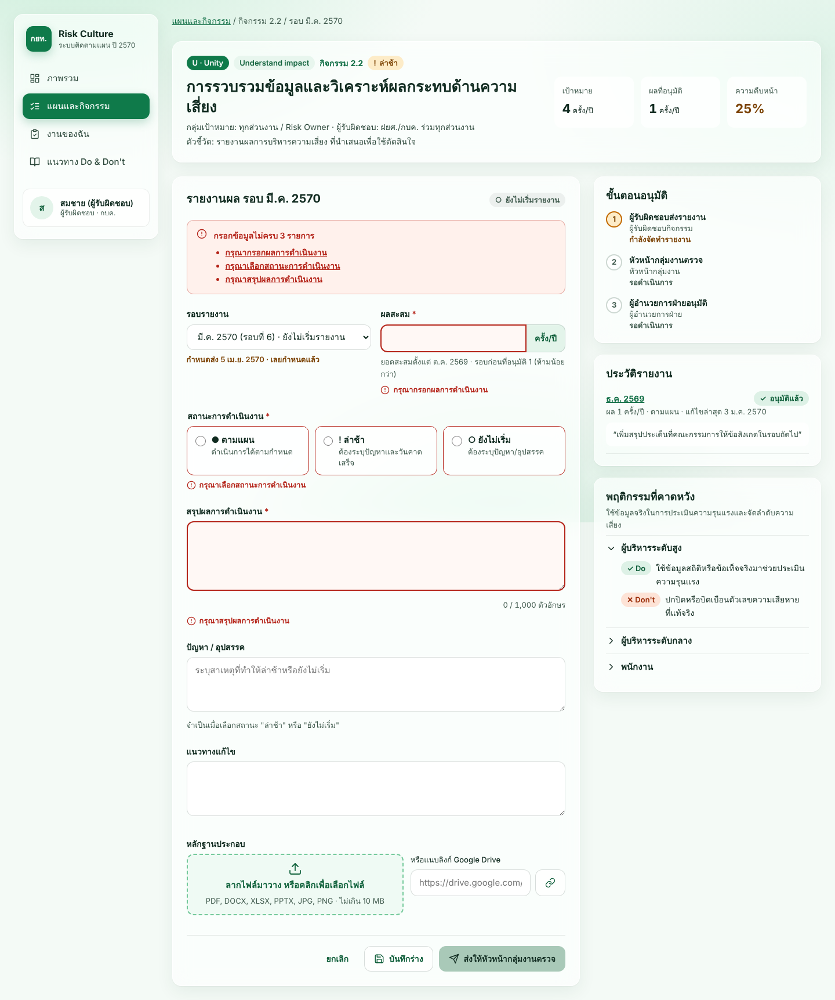
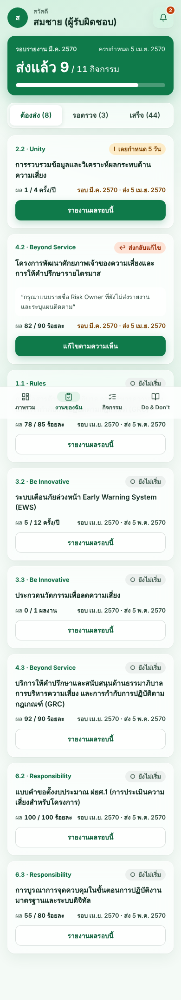

# Risk Culture Tracker · กยท. ปี 2570

ระบบติดตามและรายงานผล **แผนปฏิบัติการเสริมสร้างค่านิยมและวัฒนธรรมความเสี่ยง กยท. ประจำปี 2570**
Google Apps Script Web App + Google Sheets เป็นฐานข้อมูล · UI ธีมเขียว-ขาว Glassmorphism

- Spec ฉบับเต็ม: [`docs/SPEC.md`](docs/SPEC.md)
- Design canvas: https://claude.ai/artifact/F8owHXvghD1QKkDr1kK9j7 (ต้นฉบับ `.dc.html` อยู่ใน [`design/`](design/))
- ฐานข้อมูล: Google Sheet `1XZZQlqbgt8VAwV5PrF3rGJx62C3nL_c3_I7TwlnU1Uc`
- ภาพหน้าจอ (ข้อมูลตัวอย่าง): [`docs/screenshots/`](docs/screenshots/)

| Dashboard | รายงานผล (ฟอร์ม + validation) | มือถือ · งานของฉัน |
|---|---|---|
|  |  |  |

---

## สถานะงาน (ส่งมอบรอบนี้)

| Phase (SPEC §11) | สถานะ |
|---|---|
| 0 ยืนยัน [OPEN] | **ยังไม่ทำ** — ระบบใช้ค่า default ตามตาราง "การตีความ" ด้านล่าง ต้องให้เจ้าของงานยืนยัน |
| 1 Schema + Seed + Status + unit test | ✅ เขียนแล้ว · ทดสอบใน Node ผ่าน |
| 2 Shell + Auth + Dashboard + Activities | ✅ เขียนแล้ว · ทดสอบใน preview |
| 3 ฟอร์มรายงาน + หลักฐาน + Workflow + Audit | ✅ เขียนแล้ว · ทดสอบ integration ผ่าน |
| 4 Mobile + รออนุมัติ + Do & Don't + Export | ✅ เขียนแล้ว · ทดสอบใน preview |
| 5 Hardening | ⏳ ยังไม่ได้ทดสอบบน Apps Script จริง (ดู "สิ่งที่ทดสอบแล้ว / ยังไม่ได้ทดสอบ") |

## สิ่งที่ทดสอบแล้ว / ยังไม่ได้ทดสอบ

**ทดสอบแล้ว (อัตโนมัติ, `npm test` → 52 tests ผ่าน)**
- Unit 37 ข้อ (`src/server/Tests.gs`): รอบ/กำหนดส่ง, สถานะครบ 5 แบบ + edge case (ไม่มีรายงาน, RETURNED, DRAFT เลยกำหนด, ข้ามปีงบ, ไม่มีเดือนตามแผน), workflow ทุก transition × บทบาท, validation ทุกเงื่อนไข
- Integration 15 ข้อ (`tests/integration.js`) รัน service จริงบนฐานข้อมูลจำลอง: seed 18 กิจกรรมตรงต้นฉบับ + idempotent, flow DRAFT→APPROVED และ RETURNED, สิทธิ์ถูกปฏิเสธเมื่อเรียก endpoint ตรง (STAFF ที่ไม่ใช่เจ้าของ, EXEC_VIEWER, DIRECTOR, ผู้ใช้นอก cfg_Users), reopen เฉพาะ ADMIN, optimistic locking, cumulative ห้ามลด, whitelist ไฟล์/ลิงก์, นับเฉพาะ APPROVED, export ตรงกับ dashboard, inbox ตามบทบาท
- UI (`npm run screenshots`): 9 หน้าจอ desktop 1440px + มือถือ 390px — ไม่มี JS error, ไม่มี horizontal scroll ระดับหน้า

**ยังไม่ได้ทดสอบ**
- การรันบน Apps Script จริง (`Repo.gs`, `Session`, `LockService`, `CacheService`, Drive upload, `SpreadsheetApp.create`) — ใน dev ถูกแทนด้วย `dev/shim.js`
- `seedActivitiesFromSheet()` กับแท็บ "แผน/ผล" จริง (ทดสอบกับ fixture ที่คัดลอกจาก Sheet เมื่อ 21 ต.ค. 2569)
- ไฟล์ใหญ่ใกล้ 10 MB ผ่าน `google.script.run`, ความเร็ว Dashboard < 3 วินาทีบน 4G
- Screen reader จริง (NVDA/VoiceOver) และซูม 200%

---

## โครงสร้างไฟล์

```
src/                         ← clasp rootDir (push ขึ้น Apps Script ทั้งโฟลเดอร์)
  appsscript.json
  server/
    Main.gs            doGet + include()
    Config.gs          ค่าคงที่, schema, utility (fail_, withLock_, getSettings_)
    Repo.gs            อ่าน/เขียนแท็บ (ไม่มี business logic)
    Auth.gs            currentUser_, requireRole_, isOwner_
    Status.gs          ★ pure: รอบ, กำหนดส่ง, progress, computeActivityStatus
    Workflow.gs        ★ pure: canTransition, canEditReport
    Validation.gs      ★ pure: validateReport
    ReportService.gs   apiGetReportPage, apiSaveDraft, apiSubmit, apiTransition
    Evidence.gs        apiUploadEvidence, apiAddEvidenceLink, apiDeleteEvidence
    Dashboard.gs       apiBootstrap, apiGetDashboard, apiGetActivities, apiGetMyTasks, apiGetInbox, apiGetGuidelines
    Export.gs          apiExportSummary
    Audit.gs           writeAudit_ (append-only)
    Seed.gs            setup(), seedActivitiesFromSheet()
    Tests.gs           runTests() — รันได้ทั้งใน editor และ Node
  client/
    Index.html Styles.html App.js.html
    views/ Dashboard Activities Report MyTasks Inbox Guidelines (.html)
dev/                         ← ไม่ถูก push
  fixture.js         ข้อมูลจำลองแท็บต้นฉบับ + ผู้ใช้ทดสอบ 6 บทบาท
  shim.js            จำลอง Apps Script services + DB ในหน่วยความจำ + ข้อมูลตัวอย่าง
  build-preview.js   สร้าง dist/preview.html
  screenshots.js     ถ่ายภาพ + ตรวจ error/overflow (Playwright)
tests/  run.js integration.js
design/ *.dc.html            ← ต้นฉบับ design canvas (อ้างอิงเท่านั้น)
docs/   SPEC.md screenshots/
```

ฟังก์ชันที่ลงท้ายด้วย `_` เป็น private (client เรียกผ่าน `google.script.run` ไม่ได้) — endpoint ที่ client เรียกขึ้นต้นด้วย `api` และทุกตัวเรียก `currentUser_()` ก่อนเสมอ

---

## 1. ลองบนเครื่องก่อน (ไม่ต้อง deploy)

ต้องมี Node.js 18+

```bash
npm test                 # unit + integration (52 tests)
npm run preview          # สร้าง dist/preview.html แล้วเปิดในเบราว์เซอร์
```

`dist/preview.html` ใช้โค้ด server ชุดเดียวกับของจริง รันบนฐานข้อมูลจำลอง ณ วันที่ 10 เม.ย. 2570 (เห็นสถานะครบ 5 แบบ)
แถบ **DEV** มุมล่างซ้ายใช้สลับผู้ใช้/บทบาทและวันที่ เพื่อลอง workflow ส่ง → ตรวจ → อนุมัติ / ส่งกลับ

ภาพหน้าจอ: `npm i -D playwright && npm run screenshots` (ใช้ Chromium ในเครื่อง หรือกำหนด `CHROMIUM_PATH`)

## 2. Deploy ขึ้น Google Apps Script

### 2.1 เตรียม
1. เปิด Apps Script API: https://script.google.com/home/usersettings
2. `npm install` แล้ว `npx clasp login`

### 2.2 สร้างโปรเจกต์ผูกกับ Google Sheet เดิม
```bash
npx clasp create --type sheets --title "Risk Culture Tracker 2570" \
  --parentId 1XZZQlqbgt8VAwV5PrF3rGJx62C3nL_c3_I7TwlnU1Uc --rootDir src
npx clasp push
```
(ถ้ามี script อยู่แล้ว: คัดลอก `.clasp.json.example` เป็น `.clasp.json` แล้วใส่ `scriptId`)

> ถ้าใช้ standalone script แทน container-bound ให้ตั้ง Script Property `SPREADSHEET_ID`

### 2.3 ตั้งค่า (Apps Script editor › Project Settings › Script Properties)
| Key | Value |
|---|---|
| `EVIDENCE_FOLDER_ID` | ID ของโฟลเดอร์ Drive สำหรับหลักฐาน (แชร์เฉพาะผู้ใช้ระบบ) |
| `SPREADSHEET_ID` | (เฉพาะ standalone) ID ของ Sheet |

### 2.4 รันครั้งแรกจาก editor (ตามลำดับ)
1. `setup` — สร้างแท็บ `cfg_*`, `tx_*`, `log_Audit` + ค่า default + เพิ่มคุณเป็น ADMIN (**ไม่แตะแท็บเดิม**)
2. `seedActivitiesFromSheet` — นำเข้า 18 กิจกรรมจากแท็บ **"แผน/ผล"** (รันซ้ำได้ — คงค่า `owner_emails`, `measure_type`, `formula_note` ที่ตั้งเอง)
3. `runTests` — ควรได้ "ผ่าน 37, ไม่ผ่าน 0" ใน Execution log

### 2.5 กรอกข้อมูลผู้ใช้ในชีต
- `cfg_Users`: `email, display_name, role, unit, active(true)` — role = `STAFF | GROUP_HEAD | DIRECTOR | EXEC_VIEWER | ADMIN`
- `cfg_Activities.owner_emails`: อีเมลผู้มีสิทธิ์รายงานของแต่ละกิจกรรม คั่นด้วย `,`
- (ถ้าต้องการ) `cfg_Activities.formula_note`, `measure_type`

### 2.6 Deploy Web App
Deploy › New deployment › Web app → Execute as / Who has access ตาม `appsscript.json` → ส่ง URL ให้ผู้ใช้
อัปเดตโค้ดครั้งต่อไป: `npm run deploy` (หรือ Manage deployments › Edit › New version)

> ⚠️ **ต้องตัดสินใจก่อนใช้งานจริง (SPEC §2 [OPEN]):** `appsscript.json` ตั้งเป็น `executeAs: USER_ACCESSING` ตาม spec ซึ่งทำให้ผู้ใช้ทุกคน**ต้องมีสิทธิ์แก้ไข Sheet และโฟลเดอร์หลักฐาน** — แปลว่าเปิด Sheet แก้ข้อมูลตรงได้โดยไม่ผ่านกฎของระบบ
> ทางเลือกที่ปลอดภัยกว่า: `executeAs: USER_DEPLOYING` + `access: DOMAIN` (ผู้ใช้ไม่ต้องเข้าถึง Sheet เลย; `Session.getActiveUser()` ยังได้อีเมลเมื่ออยู่ใน Google Workspace โดเมนเดียวกัน) — **ใช้กับบัญชี @gmail.com ไม่ได้** เพราะระบบจะไม่ได้อีเมลผู้ใช้

---

## 3. ใช้กับ Claude Code

```bash
cd risk-culture-tracker
claude
```
Claude Code จะอ่าน `CLAUDE.md` อัตโนมัติ (กฎของโปรเจกต์ + คำสั่ง test/preview) ตัวอย่างคำสั่ง:

- `อ่าน docs/SPEC.md และ README หัวข้อ "การตีความ" แล้วถามฉันทีละข้อเพื่อปิด Phase 0`
- `ผู้ใช้ยืนยันว่า 4.2 ใช้ค่าเฉลี่ยสะสม — เพิ่ม measure_type AVERAGE_CUMULATIVE พร้อม test`
- `deploy ด้วย clasp แล้วช่วยตรวจ seed กับแท็บ แผน/ผล จริง`
- `เพิ่มการแจ้งเตือนทางอีเมลก่อนกำหนดส่ง 3 วัน (time-driven trigger)`

---

## การตีความที่ต้องยืนยัน (Phase 0)

| # | ประเด็น | ค่าที่ระบบใช้ตอนนี้ | แก้ที่ |
|---|---|---|---|
| 1 | Mapping มิติหมวด 5/6 | อ่านจากแท็บ "แผน/ผล" ตรง ๆ (ปัจจุบัน 5 = Embed in process, 6 = Review & Improve) | แท็บต้นฉบับ แล้ว seed ใหม่ |
| 2 | สูตร 5.1 (pp หรือ relative %) | ยังไม่คำนวณพิเศษ — ผู้รายงานกรอกค่าที่คำนวณแล้ว, `formula_note` ว่าง | `cfg_Activities.formula_note` |
| 3 | `measure_type` | `ร้อยละ` → PERCENT_LATEST, อื่น ๆ → COUNT_CUMULATIVE (ตรงตาราง SPEC 3.2) | `cfg_Activities.measure_type` |
| 4 | ผู้ใช้ / หัวหน้ากลุ่มงานต่อกิจกรรม | GROUP_HEAD ตรวจได้ทุกกิจกรรม | `cfg_Users`, (เพิ่มคอลัมน์ถ้าต้องจำกัด) |
| 5 | กำหนดส่ง | วันที่ 5 ของเดือนถัดไป | `cfg_Settings.report_due_day` |
| 6 | Deploy / domain / Drive folder | `USER_ACCESSING` + `DOMAIN` (ดูคำเตือนข้างบน) | `src/appsscript.json`, Script Properties |
| 7 | รวมกับระบบมอบหมายงาน/SIPOC | ภายหลัง — ใช้ token สีและ `cfg_Users` แบบเดียวกัน | — |
| 8 | "รายงานล่าสุดเลือก DELAYED" | รายงานรอบล่าสุดที่**ส่งแล้ว** (SUBMITTED/REVIEWED/APPROVED) | `Status.gs` |
| 9 | BELOW_TARGET | ต้องเลยกำหนดรอบสุดท้าย **และ** รอบสุดท้ายอนุมัติแล้ว (ถ้ายังรออนุมัติ = ตามแผน) | `Status.gs` |
| 10 | ปฏิทิน "ถึงรอบแต่ยังไม่ส่ง" | เดือนที่จบไปแล้วและยังไม่ส่ง | `Dashboard.gs › apiGetActivities` |
| 11 | "ส่งรายงานรอบล่าสุด" บน Dashboard | รอบของเดือนที่เพิ่งจบ (นับ SUBMITTED ขึ้นไป) | `Dashboard.gs › latestRound_` |

**สิ่งที่เพิ่มจาก spec:** คอลัมน์ `tx_Reports.return_comment` (เก็บความเห็นล่าสุดตอนส่งกลับ/reopen เพื่อแสดงให้ผู้รายงาน) และแท็บต้นฉบับชื่อจริงคือ **"แผน/ผล"** (spec เดิมเรียก `Sheet1`)

---

## การตัดสินใจด้านเทคนิค
- **Server เป็นผู้ตัดสิน:** สิทธิ์ + validation ตรวจฝั่ง server ทุก call; client ตรวจซ้ำเพื่อ UX เท่านั้น
- **Pure functions แยกไฟล์** (`Status/Workflow/Validation.gs`) จึงทดสอบใน Node ได้โดยไม่ต้อง deploy
- **เก็บทุกค่าเป็นข้อความ** (number format `@`) กัน Sheets แปลง `001001001001` เป็นตัวเลข
- **ไม่ใช้ `innerHTML`:** UI สร้างด้วย `h()` (createElement + textContent) ทั้งหมด
- **draft ไม่สูญหาย:** บันทึก draft ใน localStorage ทุกครั้งที่พิมพ์ + auto-save ทุก 30 วินาที; ถ้า version ชนกันจะไม่ทับข้อมูลและให้กู้คืนได้
- **Dashboard:** call เดียว, cache 60 วินาที, ลบ cache เมื่อมีการเขียน
- **Accessibility:** สถานะทุกจุดมีสัญลักษณ์+ข้อความ, error summary ลิงก์ไปช่องที่ผิด, `aria-invalid`, focus ring, tabs ใช้ลูกศรได้, target ≥ 44px บนมือถือ, `prefers-reduced-motion`
